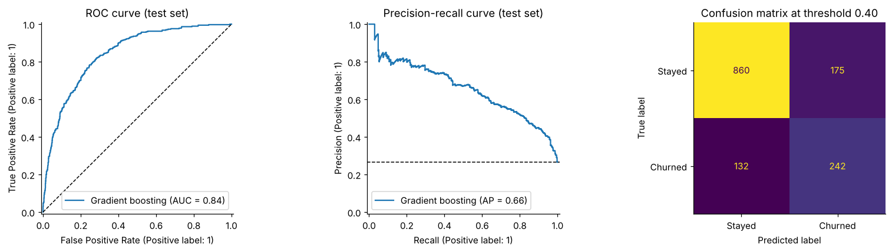

# Telco Customer Churn Prediction

A small end-to-end machine-learning project that predicts which telecom customers are likely to leave, and tests whether the model would help a retention team.

> **Status: learning project.** Built in November 2026 while studying *AI for Data Analytics* at Botswana Accountancy College. It follows the module's workflow and was developed with AI assistance. The data is a public sample dataset from a fictional company.

## Question
Can we predict churn better than a naive baseline, which factors are associated with it, and how much would the model help if only a fraction of customers can be contacted?

## Data
IBM Telco Customer Churn sample dataset: 7,043 customers, 21 columns, 26.5% churn (`data/telco_customer_churn.csv`).

## Approach
1. Clean the data (11 blank `TotalCharges` values belong to customers with zero tenure; they are imputed inside the pipeline to avoid leakage).
2. Stratified 80/20 train/test split. The test set is used once, at the end.
3. Compare a majority-class baseline, logistic regression, random forest and gradient boosting with 5-fold stratified cross-validation.
4. Evaluate the selected model on the test set with ROC-AUC, PR-AUC, precision, recall and a confusion matrix.
5. Explain it with permutation importance.
6. Measure lift and value-weighted ranking for a retention call list.

## Results (held-out test set)
| Item | Value |
|---|---|
| Cross-validated ROC-AUC (all three real models) | about 0.85 (baseline 0.50) |
| Test ROC-AUC / PR-AUC (gradient boosting) | 0.84 / 0.66 (no-skill PR-AUC 0.27) |
| Lift from contacting the top 20% by risk | about 2.5x versus random |
| Most relied-on features | contract type, tenure |

The three models are statistically indistinguishable (their ROC-AUC differs by about 0.001 against a fold-to-fold spread of about 0.01), so a simple logistic regression would do about as well. See the notebook for details and limitations.



## Limitations
One undated snapshot of a fictional operator: the model predicts risk, not the effect of a retention offer. Importance scores show association, not cause. Cost and value figures are simple assumptions.

## Run it
```bash
pip install -r requirements.txt
jupyter notebook churn_prediction.ipynb
```

## Data source
IBM Telco Customer Churn sample dataset (public sample data, fictional company).
